<div align="center">


# DSH Workbench for Herdr

**在 DeepSeek Harness（DSH）Web 里查看并安全地操作 Herdr 的工作区、终端和 AI 编程 Agent。**<br>
默认只读，取得控制始终是一个单独确认的步骤。

[](https://github.com/NAMEWTA/dsh-plugin-herdr/actions/workflows/ci.yml)
[](https://github.com/NAMEWTA/dsh-plugin-herdr/releases)
[](LICENSE)
[](#兼容性)
[](#兼容性)
[](#兼容性)

[English](README.md) · **简体中文**

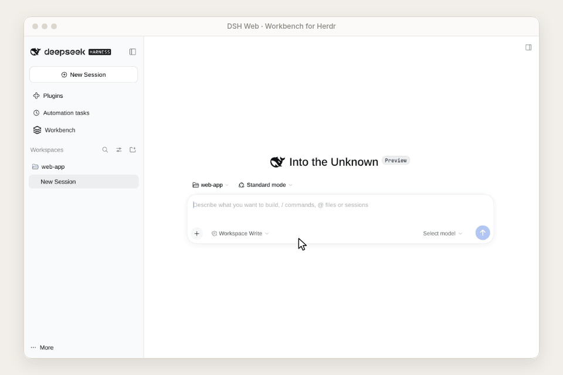

</div>

> **状态：alpha 预览版（`1.0.4-alpha.1`）。** 以 GitHub prerelease 的 tarball 发布，不发布到 npm。已在 Linux x86_64 + DSH 0.2.1-rc.2 + Herdr 0.9.3 上验证。详见[发布说明](docs/releases/1.0.4-alpha.1.md)。
>
> 演示动图和大部分截图录制时界面语言为英文，G6 演示了切换到简体中文；界面语言可在“外观设置”里随时切换。

## 目录

[为什么需要它](#为什么需要它) · [功能](#功能) · [快速上手](#快速上手) · [使用](#使用) · [配置](#配置) · [安全模型](#安全模型) · [兼容性](#兼容性) · [排障](#排障) · [升级与迁移](#升级与迁移) · [开发](#开发) · [参与贡献](#参与贡献) · [许可证与致谢](#许可证与致谢) · [附录：原 README 存档](#附录原-readme-存档)

## 为什么需要它

[Herdr](https://github.com/herdrdev/herdr) 是给 AI 编程 Agent 用的终端工作区管理器，把很多个 shell 和 Agent（Claude Code、Codex 等）按工作区、标签页、窗格组织起来常驻运行。[DeepSeek Harness](https://www.npmjs.com/package/@deepseek-ai/dsh) 则是你在浏览器里和模型对话的地方。没有桥接的话，你只能在两者之间来回切换，在 DSH 里也看不到 Agent 正在做什么。

DSH Workbench for Herdr 把 Herdr 带进 DSH Web：一个总览看全部工作区，终端可以放心地只读观察，只有你明确要求时才取得控制。DSH 会话还可以绑定到一个 Herdr 工作区，让模型能看到它，并在你批准后对它执行操作。

## 功能

### 所有工作区和窗格的总览

通过 Herdr socket 汇总工作区、标签页、窗格和 Agent 状态（`working`、`blocked`、`idle`、`done`、`unknown`），并用“需要关注”收件箱列出需要介入的事项。更新走 Herdr 的事件推送，推送不可用时自动降级为轮询。

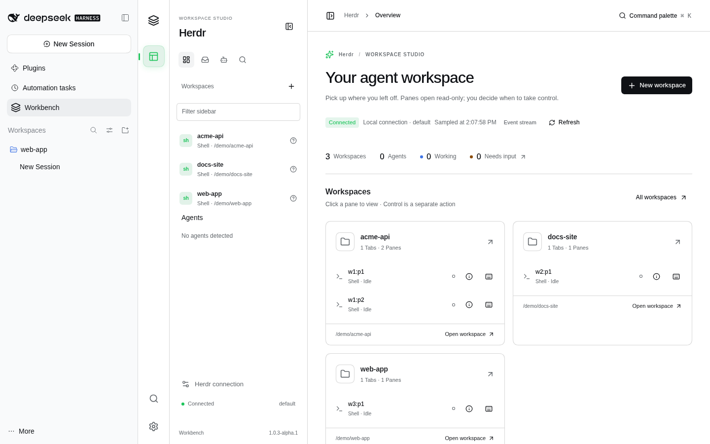

### 先观察，按需控制

点开窗格会以**只读观察**模式接入浏览器终端（xterm），这时不接收输入。点 **Acquire control（取得控制权）**会先弹出确认框。如果窗格不是在 Workbench 里创建的，确认后也只接管这一个窗格。点 **Observe（只读观察）**即可回到只读。控制租约在 Workbench 内互斥，断线后不会重放未确认的按键。

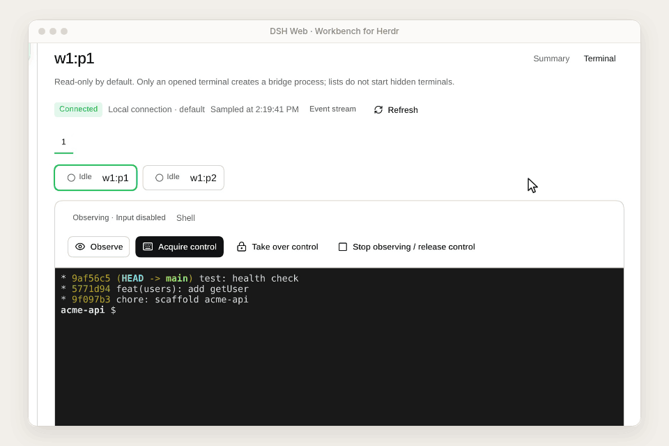

### 每个 DSH 会话里都有 Herdr 页签

DSH 会话的右侧栏多了一个 **Herdr** 页签。会话有项目路径且尚未绑定时，这个路径会自动成为该会话的工作区，不需要再点创建，也不需要先让模型调用工具。只有解析不出项目路径时才显示「此会话还没有工作区」。之后页签里会显示会话树（工作区 › 标签页 › 终端），也可以直接打开终端。

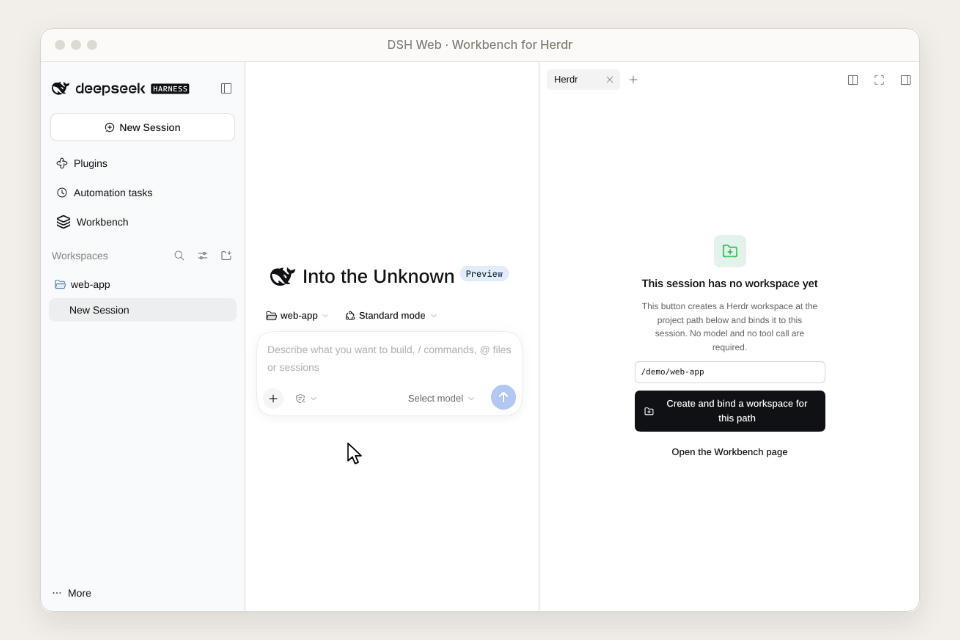

绑定同时限定了模型工具的范围：`workbench_herdr_inspect`（第一次调用会按项目路径自动绑定，之后只读该工作区）、`workbench_herdr_launch`（启动 Codex 或 Claude Code，不向它们发送内容，每次都要经过 DSH 审批）和 `workbench_herdr_action`（只改已绑定工作区里的资源，同样要审批）。详见[让模型帮忙](#让模型帮忙)。

### 命令面板

按 <kbd>Ctrl</kbd>/<kbd>⌘</kbd> <kbd>K</kbd> 或点 **Command palette（命令面板）**，可以跳到总览、需要关注、工作区、Agent、终端、窗格详情、环境，也可以新建工作区。

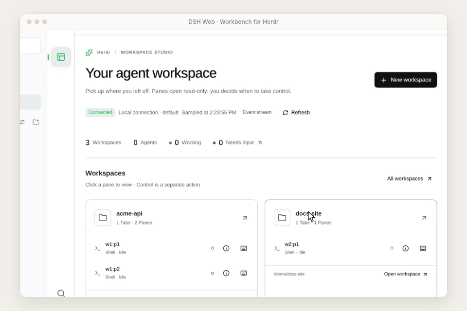

### 环境与诊断

**环境与连接**页显示 DSH 宿主平台、Herdr CLI 路径和版本、批准的工作区根目录、运行中的服务（版本、协议、socket、session）、宿主 Node 进程的 CPU 和 RSS，以及终端资源配额。检测本身不会安装软件或启动服务，只有你点 **Start service（启动服务）**时才会启动。

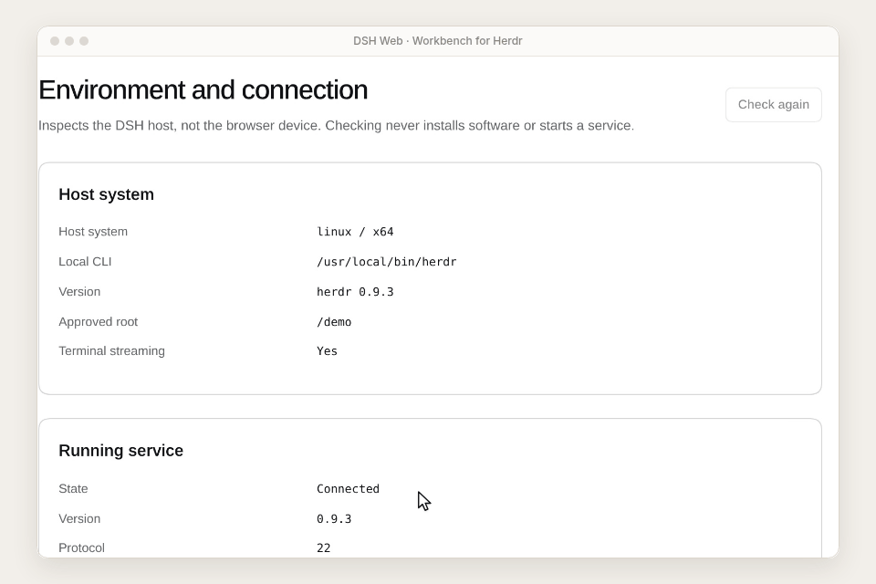

### 语言、主题、密度和窄屏

支持 English 或简体中文，浅色、深色或跟随系统，舒适或紧凑密度，窄屏下改用抽屉布局。这些设置只影响 Workbench，不影响 DSH 宿主。

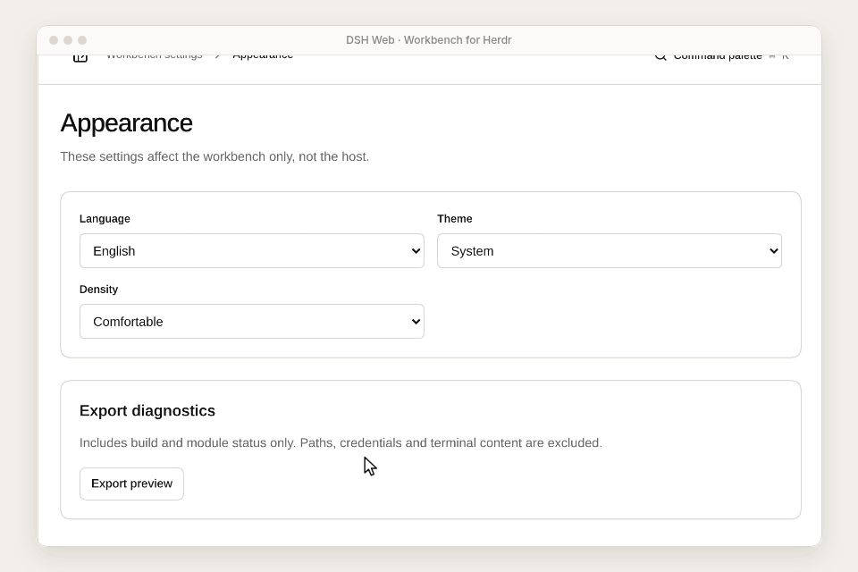

| 深色 · 简体中文 | 窄屏 |
|---|---|
| 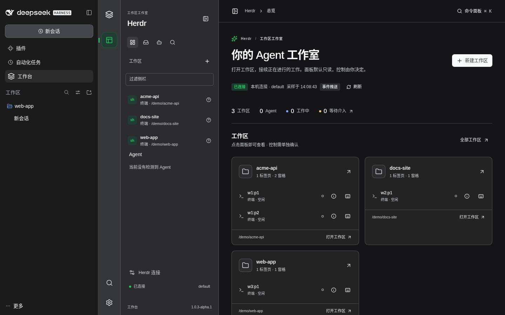 | 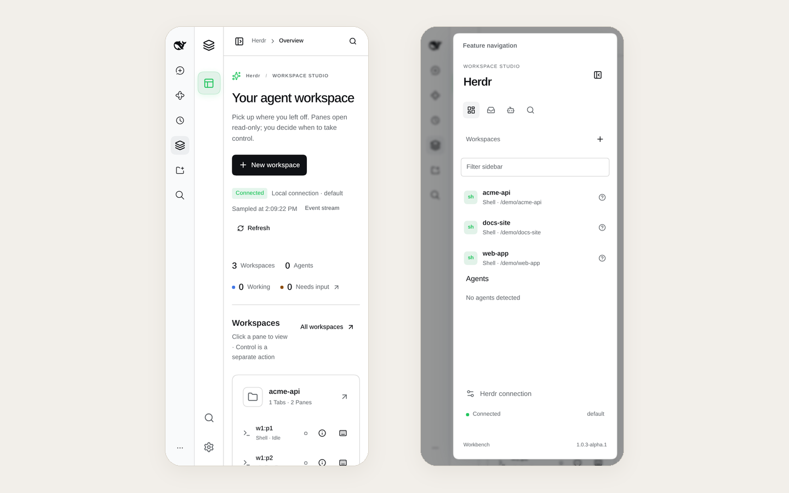 |

<details>
<summary>更多截图</summary>

| 终端：只读观察 | 取得控制权的确认框 |
|---|---|
| 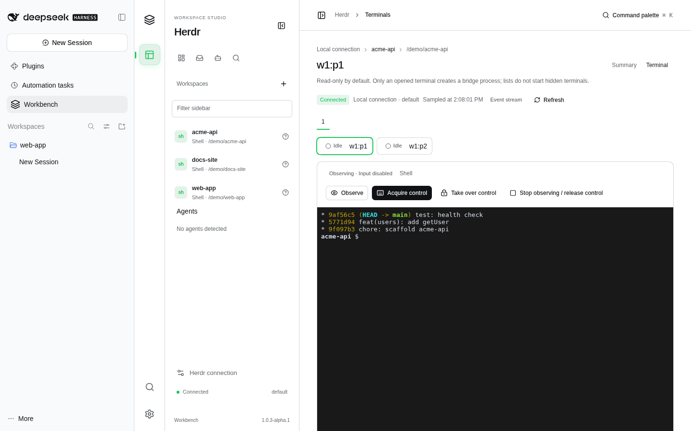 | 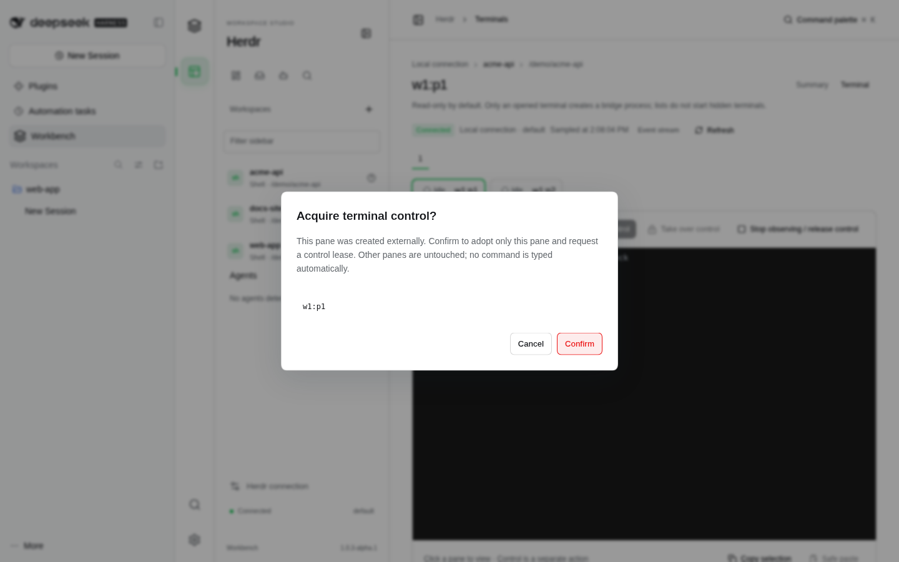 |
| **会话右侧栏** | **命令面板** |
| 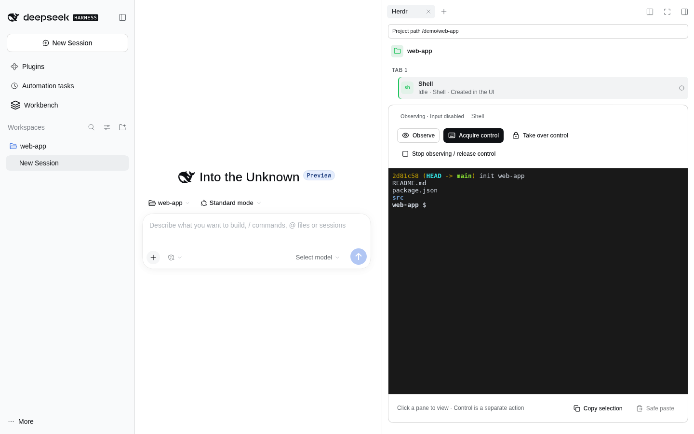 | 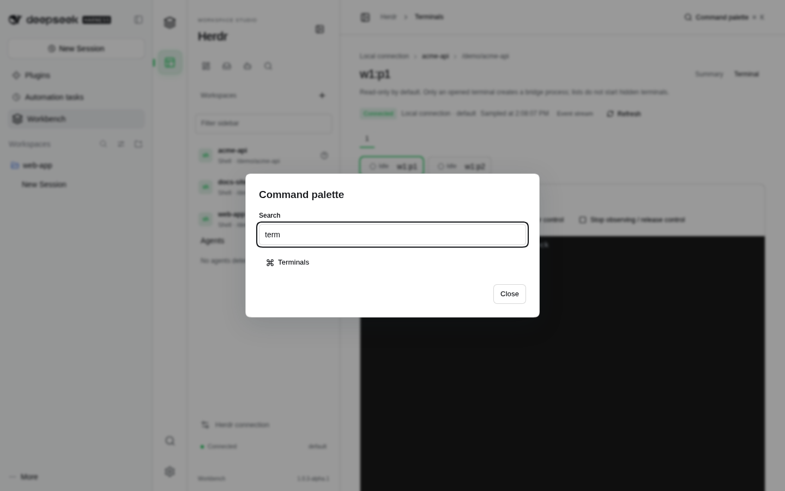 |
| **环境与连接** | |
| 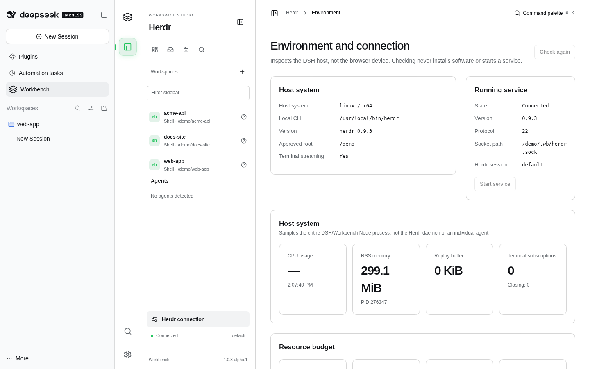 | |

</details>

## 快速上手

### 前置条件

| | 版本 | 说明 |
|---|---|---|
| 操作系统 | Linux x86_64 | CI 验证的目标平台。macOS、原生 Windows、WSL 未验证。DSH 和 Herdr 必须在同一台机器上，浏览器可以在别处。 |
| Node.js | 24.22.0 及以上、25 以下 | DSH 和本包的 `engines` 要求。 |
| DeepSeek Harness | 0.2.1-rc.2 | `npm install --global @deepseek-ai/dsh@0.2.1-rc.2` |
| Herdr | 0.9.3（protocol 22） | 见第 1 步。其他协议版本最多只能读，写操作会被拒绝。 |

### 1. 安装 Herdr 0.9.3

```sh
mkdir -p ~/.local/bin
curl -fL https://github.com/herdrdev/herdr/releases/download/v0.9.3/herdr-linux-x86_64 -o ~/.local/bin/herdr
echo "18a8dc65f1c2fa485884344356dea1cfd911c6f06cf46fa78e193f4087f4dba7  $HOME/.local/bin/herdr" | sha256sum --check
chmod +x ~/.local/bin/herdr
```

### 2. 下载并校验插件

```sh
V=1.0.4-alpha.1
BASE=https://github.com/NAMEWTA/dsh-plugin-herdr/releases/download/v$V
for f in namewta-dsh-workbench-$V.tgz build.json SHA256SUMS; do curl -fLO "$BASE/$f"; done
sha256sum --check --ignore-missing SHA256SUMS
```

`build.json` 记录了构建对应的源码提交，以及固定的 `dsh`、`herdr` 和协议版本。

### 3. 装进 DSH 的 web profile

```sh
dsh plugin --profile web add "$PWD/namewta-dsh-workbench-$V.tgz"
```

请安装构建好的 `.tgz`，不能直接添加源码目录。安装时出现 `@deepseek-ai/*` 相关的 peer 依赖提示是正常的，这些包由 DSH 在运行时提供。

### 4. 启动 Herdr 和 DSH Web

```sh
herdr            # 打开 Herdr TUI 并启动常驻服务（也可以用 herdr server）
dsh web          # 在另一个终端运行；会打印一个带一次性 token 的本地地址
```

打开打印出来的地址。首次启动时，DSH 会先弹出 **Preview Notice**（点 **Continue**），再弹出 **Get started**，要求登录 DeepSeek 或填写 API Key。**按 <kbd>Esc</kbd> 关掉 Get started 即可**，Workbench 不需要模型。然后点 DSH 侧栏里的 **Workbench**。

> 如果 Herdr 还没启动，可以在**环境与连接**页点 **Start service**。如果 Herdr 用的不是默认 socket，请设置 `socket`（见[配置](#配置)）。

## 使用

### 观察与取得控制

1. 在总览或终端页点一个窗格（例如 `w1:p1`），终端以 **Observing · Input disabled（观察中 · 不接收输入）**打开。
2. 点 **Acquire control** 并确认。如果窗格不是 Workbench 创建的，确认框会说明只接管这一个窗格，也不会自动输入任何内容。
3. 在终端里输入，状态显示为 **Controlling · Live terminal input（控制中 · 输入进入真实终端）**。
4. 点 **Observe** 回到只读，或点 **Stop observing / release control（停止观察 / 释放控制）**断开。关闭视图只会释放桥接进程，shell 和 Agent 会在 Herdr 里继续运行。

**Take over control（接管控制权）**是单独的操作，用来撤销另一个 Workbench 窗口持有的控制租约，由当前窗口接管。粘贴要通过 **Safe paste（安全粘贴）**，发送前需要确认。

### 管理资源

在 Workbench 里可以新建工作区（必须在批准的根目录下）、重命名、拆分窗格、新建标签页、启动批准的 Agent（默认是 `claude` 和 `codex`）、关闭资源，以及显式接管在 Workbench 之外创建的资源。破坏性操作需要确认。关闭页面或停用插件时，Workbench 不会关闭外部的 Agent。

### 绑定 DSH 会话

打开一个带项目路径的会话。Herdr 页签会把这个目录绑定为该会话的工作区。Workbench 不会退回去用“当前聚焦的工作区”。Herdr 重启后，过期的绑定会失效关闭，不会误连。没有项目路径的会话会保持未绑定，直到手动选择。

### 让模型帮忙

`toolsEnabled` 开启时（默认开启），模型可以使用三个工具：

| 工具 | 能做什么 |
|---|---|
| `workbench_herdr_inspect` | 读取当前会话的工作区。第一次调用时，若尚未绑定，就按会话项目路径创建或复用并绑定。没有项目路径时返回 `INVALID_REQUEST`。 |
| `workbench_herdr_launch` | 在该工作区启动 Codex 和 Claude Code，并且不发送内容。示例：`{"agents":[{"kind":"codex","count":4},{"kind":"claude","count":4}],"send":false}`。一次最多 8 个。每次调用都会先弹出 DSH 审批框。 |
| `workbench_herdr_action` | **在已绑定的工作区内**重命名、关闭、拆分或新建标签页。不用于启动 Agent。每次调用都会先弹出 DSH 审批框。不能发送原始按键，不能隐式接管资源，也不能跨工作区操作。 |

Agent 预设 **Workbench · Herdr** 会引导模型按这种方式使用工具。使用模型需要 DSH 已登录或已配置 API Key。

## 配置

Workbench 在 profile 里的条目 id 是 `namewta-workbench`。在 profile 的补丁层 `~/.dsh/profiles/web/cordis.patch.yml`（或 `$DSH_HOME/profiles/web/…`）里覆盖配置，然后重启 `dsh web`：

```yaml
- id: namewta-workbench
  config:
    socket: /home/me/.config/herdr/herdr.sock
    readOnly: false
    maxObservers: 8
```

可以用 `dsh web --dump-config` 查看合成后的结果。所有路径都必须是绝对路径。

| 键 | 默认值 | 说明 |
|---|---|---|
| `socket` | `~/.config/herdr/herdr.sock` | Herdr API socket。非 default session 时使用其 sessions 子目录。自定义 XDG 路径时请显式设置。 |
| `session` | `default` | Herdr session 名（字母、数字、`_`、`-`，1–64 个字符）。 |
| `binary` | 自动 | `herdr` 的路径。未设置时依次使用 `WORKBENCH_HERDR_BINARY` 和受控的 PATH 查找。显式路径错误时不会悄悄换成别的程序。 |
| `workspaceRoot` | DSH 工作目录 | 新建工作区的路径经 realpath 解析后必须位于这个根目录内。 |
| `dataDirectory` | `<profile>/workbench/` | Workbench 的状态数据（绑定、台账、审计）。 |
| `readOnly` | `false` | 只授予读取和观察权限，不能取得控制，也不能修改资源。 |
| `pollMs` | `3000` | 事件推送不可用时的轮询间隔（500–30000）。 |
| `toolsEnabled` | `true` | 注册三个模型工具。 |
| `maxObservers` | `8` | 同时观察的会话数（0–64）。 |
| `maxControllers` | `2` | 同时控制的会话数（0–16）。 |
| `maxProcesses` | `16` | 终端桥接进程数，正在清理的也计入（1–128）。 |

环境变量：`WORKBENCH_HERDR_SOCKET`（socket）和 `WORKBENCH_HERDR_BINARY`（binary），例如：

```sh
WORKBENCH_HERDR_SOCKET=/abs/path/herdr.sock WORKBENCH_HERDR_BINARY=/abs/path/herdr dsh web
```

## 安全模型

取得终端控制权，就等于以运行 Herdr 的用户身份执行程序。Workbench 是控制面，不是沙箱。

| 谁 | 能做 | 不能做 |
|---|---|---|
| 任何通过 DSH 认证的浏览器 | DSH 宿主操作者能做的一切，信任级别与 `dsh web` 本身相同 | — |
| 观察者 | 读取终端输出和状态 | 发送输入 |
| 控制者 | 向持有租约的窗格输入 | 持有超过 `maxControllers` 个租约；断线后重放未确认的输入 |
| 模型 | `inspect` 会按会话项目路径绑定后再读取；`launch` 经批准后启动 Agent 且不发送内容；`action` 经批准后修改该工作区 | 使用其他会话或当前聚焦工作区；发送 prompt 或原始按键；未经批准接管或关闭无关的外部资源 |
| `readOnly: true` | 读取和观察 | 控制、新建、关闭 |

- 身份来自 DSH 服务端（`invocation.peer.id`），不采信浏览器自报的身份。每一次读取、写入和流消息都在服务端鉴权。
- 终端输出由 xterm 按字节解析，不会当作 HTML 渲染。OSC 52 剪贴板写入会被拦截，粘贴需要确认。
- 数据文件使用 `0700`/`0600` 权限。审计只记录元数据，不记录按键、输出、环境变量或凭据。
- 这是单用户的本地产品。请只在受信设备或私网中使用 DSH 端口，也不要分享启动地址，因为它包含一次性 token。

详见 [docs/security.md](docs/security.md)。

## 兼容性

| 组件 | 已验证 | 未验证 |
|---|---|---|
| 操作系统 | Linux x86_64（CI 为 Ubuntu 24.04；本 README 的录制环境为 Debian 13） | macOS、原生 Windows、WSL |
| DSH | 0.2.1-rc.2 | 0.2.1-alpha.x 及其他版本 |
| Herdr | 0.9.3，protocol 22 | 其他版本（显示为不兼容，拒绝写入） |
| Node.js | CI 为 24.22.0，本地为 24.22.1 | Node 25 及以上（超出 `engines`） |
| 浏览器 | Chromium（Playwright 1.64.1）、Google Chrome | Firefox、Safari（未自动化测试） |

详见 [docs/support.md](docs/support.md) 和 [docs/acceptance.md](docs/acceptance.md)。

## 排障

| 现象 | 处理 |
|---|---|
| “Get started”弹窗挡住页面 | 按 <kbd>Esc</kbd>。Workbench 不需要 DeepSeek 账号，只有聊天和工具审批才需要。 |
| Workbench 显示**离线** | Herdr 没在运行，或者 socket 不一致。启动 `herdr`（或点 **Start service**），并让 `socket` 与 `herdr status` 输出的 `api socket` 一致。 |
| 自定义了 `XDG_CONFIG_HOME` 或 `HERDR_SOCKET_PATH` | 给 `herdr` 和 `dsh web` 设置同样的环境变量，或者显式设置 `socket`。 |
| 协议显示**不兼容** | 安装 Herdr 0.9.3（protocol 22）。其他协议不会被写入。 |
| DSH 弹出 “Unable to create default workspace” | DSH 还没有项目目录。点 DSH 侧栏的 **Add workspace** 选一个目录。 |
| 窗格状态一直是 *Idle* / *Unknown* | Agent 状态来自在 Herdr 窗格里运行的受支持 Agent CLI（Claude Code、Codex）。普通 shell 会一直显示为空闲。 |
| `dsh plugin add` 打印 peer 依赖提示 | 正常现象，这些包由 DSH 提供。 |
| `pnpm test:e2e` 找不到浏览器 | 运行 `pnpm exec playwright install chromium`。 |

## 升级与迁移

`@namewta/dsh-workbench` 1.x **替换**了早期的 `@namewta/dsh-plugin-herdr` 0.0.x 和上游的 `dsh-plugin-herdr`，不是原地升级：

- 不支持旧的配置键、工具名（旧的 `herdr_*` 工具）、导出和预设，也没有迁移层。
- 安装新包不会卸载旧包。不再使用旧包时，执行 `dsh plugin --profile web remove @namewta/dsh-plugin-herdr`（或 `dsh-plugin-herdr`），然后重启对应 profile。Herdr 的工作区、窗格和 DSH profile 都不会受影响。
- 卸载 Workbench：`dsh plugin --profile web remove @namewta/dsh-workbench`。外部 Agent 会继续运行，数据目录会保留，由你决定备份或删除。

更多内容见 [docs/installation.md](docs/installation.md) 和 [docs/provenance.md](docs/provenance.md)。

## 开发

需要 Node 24.22.0 和 pnpm 10.28.2。

```sh
pnpm install --frozen-lockfile
pnpm quality            # 构建、类型检查、架构/协议/契约检查、单元/组件/打包测试
pnpm dev                # 使用模拟数据的开发宿主（带 DEVELOPMENT FIXTURE 横幅），不需要 DSH 和 Herdr
HERDR_TEST_BINARY=/abs/path/to/herdr-0.9.3 pnpm test:integration   # 真实 Herdr 集成测试
pnpm exec playwright install chromium && pnpm test:e2e
pnpm pack:plugin        # 先构建，再生成 artifacts/namewta-dsh-workbench-<version>.tgz
node tooling/check-package.mjs artifacts/*.tgz
```

<details>
<summary>仓库结构</summary>

```text
apps/dsh-plugin           最终发行包与装配入口
apps/dev-workbench        无 DSH/Herdr 的模拟开发宿主
packages/platform-*       中立契约、模块运行时、权限、操作、审计端口
packages/module-sdk       Manifest、贡献、生命周期与存储接口
packages/ui               唯一公共 UI 入口、主题、密度、表单与浮层
packages/workbench-shell  导航、命令面板、模块管理、设置与审计
adapters/dsh              DSH 公开槽位、Remote、工具与持久化适配
modules/herdr             Herdr 领域、应用、基础设施和 Web 功能
modules/example-notes     第二模块扩展证明；不进入发行包
```

Herdr 是 Workbench 的第一个模块。详见 [docs/architecture.md](docs/architecture.md) 和 [docs/module-guide.md](docs/module-guide.md)。
</details>

## 参与贡献

欢迎在 [NAMEWTA/dsh-plugin-herdr](https://github.com/NAMEWTA/dsh-plugin-herdr/issues) 提 issue 和 PR。改代码前请先阅读 [AGENTS.md](AGENTS.md)（边界、安全规则、验证要求）、[docs/architecture.md](docs/architecture.md) 和 [docs/testing.md](docs/testing.md)。提 PR 前请运行 `pnpm quality` 和真实 Herdr 集成测试。缺少前置条件算作失败，不能当作跳过。

## 许可证与致谢

[MIT](LICENSE) © 2026 NAMEWTA，© 2026 sunny0826。

- 本项目基于 [sunny0826/dsh-plugin-herdr](https://github.com/sunny0826/dsh-plugin-herdr)，也就是最初的 DSH Herdr 插件。保留的协议传输和终端生命周期代码按 MIT 许可源自该项目。感谢 sunny0826。
- 部分交互借鉴了 [Ovis](https://github.com/devswha/ovis)（MIT）。见 [THIRD_PARTY_NOTICES.md](THIRD_PARTY_NOTICES.md) 和 [NOTICE](NOTICE)。
- [Herdr](https://github.com/herdrdev/herdr) 和 [DeepSeek Harness](https://www.npmjs.com/package/@deepseek-ai/dsh) 是外部项目，本项目与它们没有隶属关系。
- 发行 tarball 包含 `NOTICE`、打包依赖的许可证、CycloneDX SBOM，以及记录源码提交的 `build.json`。

## 附录：原 README 存档

以下是本次改版前 `README.md`（中文主文档）和 `README.zh-CN.md` 的原文，原样保留供维护者查阅。

<details>
<summary>原 README.md（1.0.3-alpha.1）</summary>

### Workbench

> 当前预览版是 `1.0.3-alpha.1`，宿主基线是 DSH `0.2.1-rc.2`。已经发布的 `v1.0.2-alpha.1` 附件保持不变，那一版仍是旧 `0.2.1-alpha.2` 宿主构件，不要把它当成 rc.2 包。合并到 main 并通过三项验收后，CI 发布 `v1.0.3-alpha.1` prerelease，不覆盖旧 Release，不发布 npm。安装前核对 `build.json` 中的源码 SHA 与 `dsh` 字段。

**独立维护、功能模块化的开发工作台。Herdr 是第一个模块，而不是整个平台。**

`@namewta/dsh-workbench` 替换旧插件架构：统一 React 界面、第一方模块 SDK、服务端授权、明确的资源归属和受控终端。没有旧 API、旧配置、旧导出或旧预设兼容层。旧插件不被自动卸载，已有工作区和 Agent 不被迁移或删除。

> 当前版本为 `1.0.3-alpha.1` 预览版；GitHub 构件仅在 main 验收通过后发布，不发布 npm，也不覆盖 `v1.0.2-alpha.1`。GitHub 仓库仍位于原 fork 网络；代码重构不等于完成管理员侧的脱离操作。[发布说明](docs/releases/1.0.3-alpha.1.md)与[验收边界](docs/acceptance.md)列明未完成项。

#### 产品结构

```text
apps/dsh-plugin          最终发行包与装配入口
apps/dev-workbench       无 DSH/Herdr 的模拟开发宿主
packages/platform-*     中立契约、模块运行时、权限、操作、审计端口
packages/module-sdk     Manifest、贡献、生命周期与存储接口
packages/ui             唯一公共 UI 入口、主题、密度、表单与浮层
packages/workbench-shell 导航、命令面板、模块管理、设置与审计
adapters/dsh            DSH 公开槽位、Remote、工具与持久化适配
modules/herdr           Herdr 领域、应用、基础设施和 Web 功能
modules/example-notes   第二模块扩展证明；不进入发行包
```

总览优先显示待处理事项，工作区、Agent、终端、环境与连接使用同一套设计系统。支持中文/英文、明暗/系统主题、舒适/紧凑密度、卡片/表格、键盘命令面板和窄屏布局。终端列表不会创建隐藏观察进程；xterm 资源只在用户打开终端时加载。

#### 开发与验证

冻结基线：Node **24.22.0**、pnpm **10.28.2**。先安装这些版本，再执行：

```sh
pnpm install --frozen-lockfile
pnpm quality
pnpm dev
```

开发页面使用模拟数据，不代表真实终端或远程部署通过验收。附加验证：

```sh
HERDR_TEST_BINARY=/absolute/path/to/herdr-0.9.3 pnpm test:integration
pnpm exec playwright install chromium
pnpm test:e2e
pnpm pack:plugin
node tooling/check-package.mjs artifacts/*.tgz
HERDR_TEST_BINARY=/absolute/path/to/herdr-0.9.3 node tests/e2e/dsh.mjs /absolute/path/to/dsh/lib/bin.js artifacts/*.tgz
```

`pnpm pack:plugin` 会先执行 `pnpm build`（生成 `lib/sbom.cdx.json`、客户端样式和校验清单），再把 tarball 写到 `artifacts/`。不必在 pack 之前单独 build。安装的仍然是这个 tarball，不是源码目录。

集成环境缺失会失败，不会跳过后报告通过。CI 固定 Linux x86_64、Herdr 0.9.3/protocol 22 和 DSH 0.2.1-rc.2。PR 只生成候选包；main 必须重新通过全部质量、真实集成和浏览器检查，才将同次运行的构件发布为已授权的 GitHub alpha。既有 Release 不覆盖，npm 不发布。

#### 安装和使用

见[安装与配置](docs/installation.md)。安装的是构建后的 `.tgz`，不是源码目录。进入 DSH 侧栏 **Workbench** 后，先查看**环境与连接**，再创建工作区或明确接管现有资源。

观察终端默认只读。取得控制权、接管、关闭资源均需独立确认。控制互斥仅覆盖 Workbench 的租约，不声称阻止其他 Herdr TUI。退出页面只释放桥接进程，不关闭外部 shell/Agent。

#### 文档

[架构](docs/architecture.md) · [模块开发](docs/module-guide.md) · [安全模型](docs/security.md) · [测试与证据](docs/testing.md) · [支持基线](docs/support.md) · [需求状态台账](docs/requirements-status.csv) · [获批设计](docs/design-baseline.md) · [来源与独立化](docs/provenance.md)

#### 许可证

MIT。保留 NAMEWTA 与 sunny0826 的必要版权通知。发行包包含 `NOTICE`、实际打包依赖的许可证、CycloneDX SBOM、源码 SHA 和构件校验清单。独立维护不抹去保留代码的来源。


</details>

<details>
<summary>原 README.zh-CN.md</summary>

### Workbench 简体中文文档

主文档已统一为中文：[README](README.md)。

这是不保留旧运行时兼容层的模块化重构，包名为 `@namewta/dsh-workbench`。请先阅读 [安装说明](docs/installation.md)、[支持基线](docs/support.md) 和 [尚未完成的发布验收](docs/acceptance.md)。不要按旧插件的配置、导出、工具名称或安装命令使用新包。

</details>
